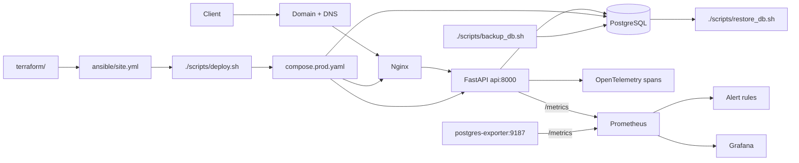

# Architecture

## Components

| Layer | Component | Responsibility |
| --- | --- | --- |
| Edge | Nginx + Let's Encrypt | TLS termination, security headers, request limits, reverse proxy |
| Edge | `scripts/init_certs.sh` | Bootstraps local self-signed or real Let's Encrypt certificates before Nginx starts |
| Application | FastAPI (`app.main`) | `/tasks`, `/profile`, `/health`, `/metrics`, HTTP middleware |
| Observability | OpenTelemetry API | Request spans and task-creation spans (no exporter configured) |
| Observability | Prometheus | Scrapes `api:8000/metrics` and `postgres-exporter:9187/metrics` |
| Observability | Grafana | Provisioned Prometheus datasource and SecureAPI dashboard |
| Data | PostgreSQL | Primary datastore with a persistent volume |
| Data | Backup scripts | `./scripts/backup_db.sh`, `./scripts/restore_db.sh` |
| Runtime | Docker Compose | Production stack defined in `compose.prod.yaml` |
| Configuration | Ansible | Server and application orchestration via `ansible/site.yml` |
| Infrastructure | Terraform | VPS and supporting resources in `terraform/` |

Metrics are generated in-process by the standard-library implementation in
`app/monitoring.py`. The `/metrics` endpoint is excluded from instrumentation so
scraping does not change the numbers being observed, and Nginx blocks public
access to it. Label values are escaped,
raw paths are normalized (numeric and UUID segments become placeholders), and
the router's matched path is preferred over the raw URL to keep cardinality low.

## Request flow

## Deployment layers

1. `terraform/` provisions the VPS, network rules and DNS prerequisites.
2. `ansible/site.yml` hardens the host, installs Docker, and renders secrets.
3. `./scripts/deploy.sh` starts or updates the stack from `compose.prod.yaml`.
4. `monitoring/` provides scrape configuration, alert rules and Grafana
   provisioning for the running stack.
